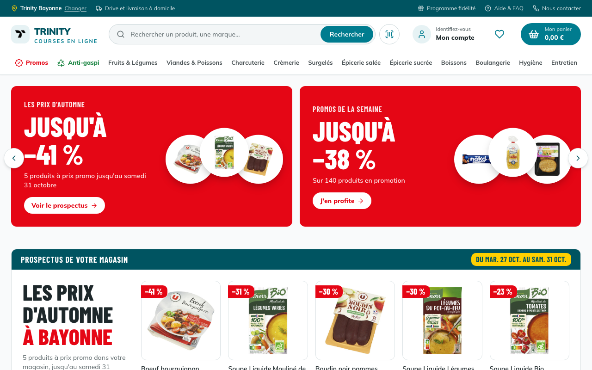
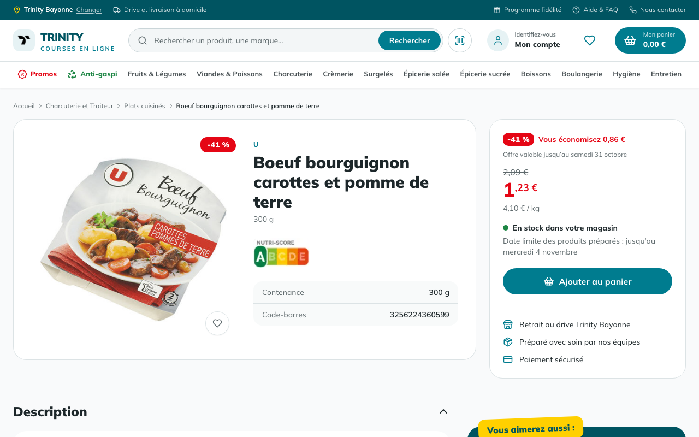
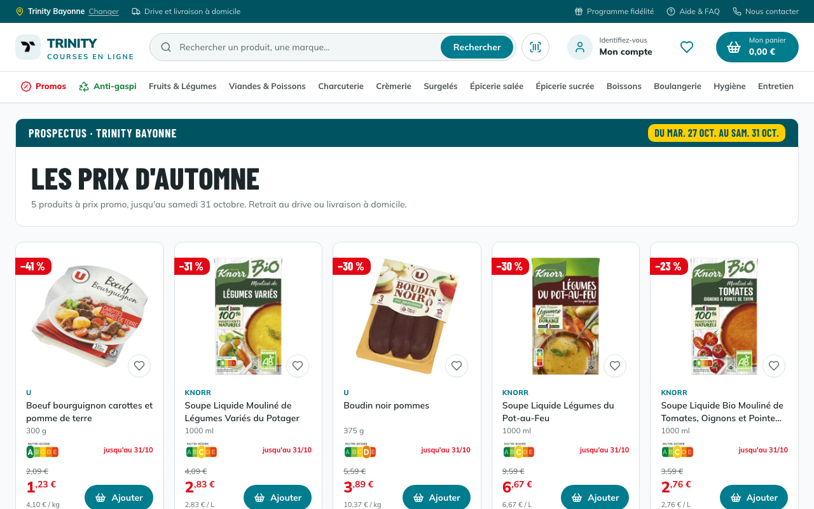
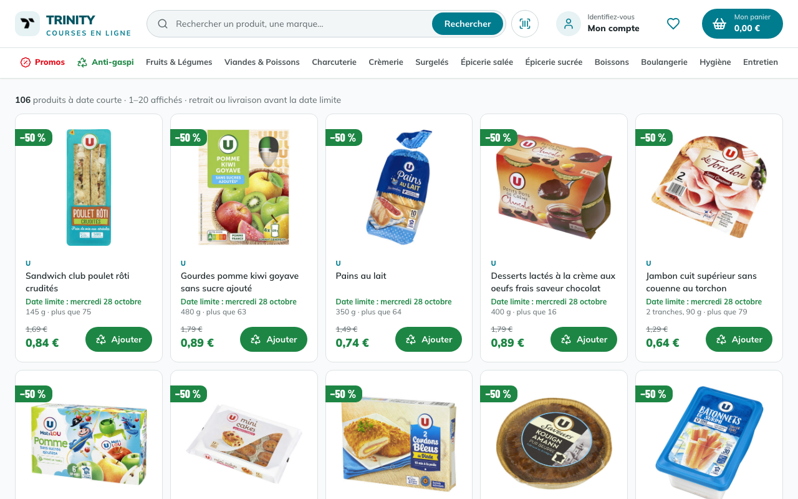
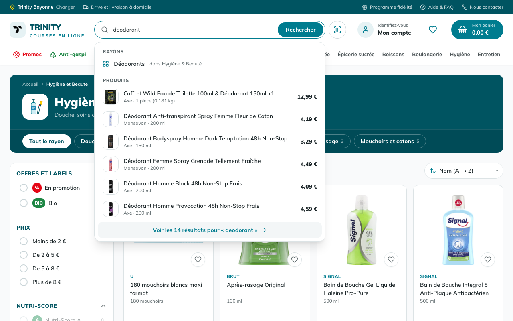
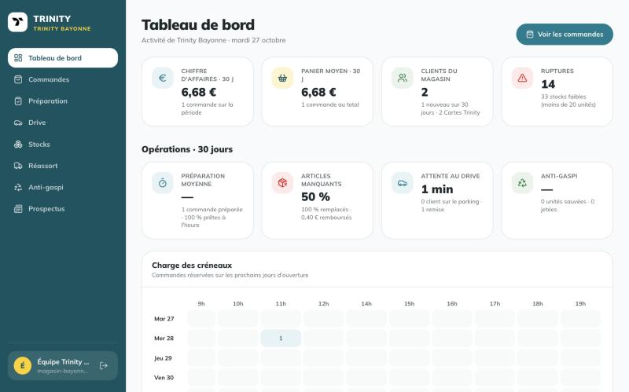
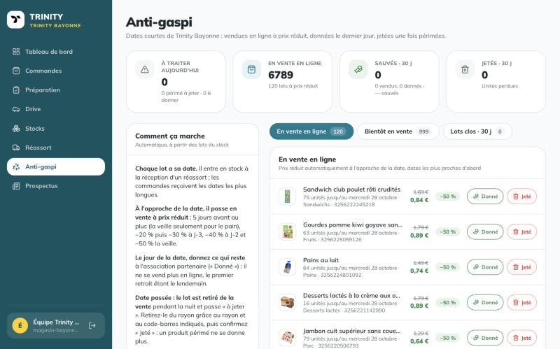
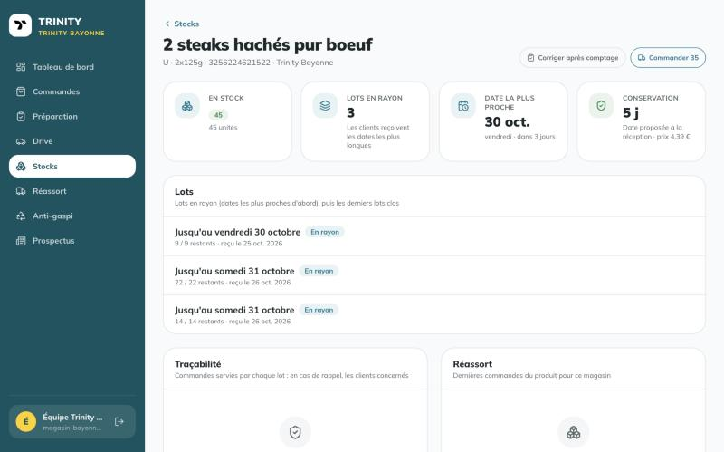
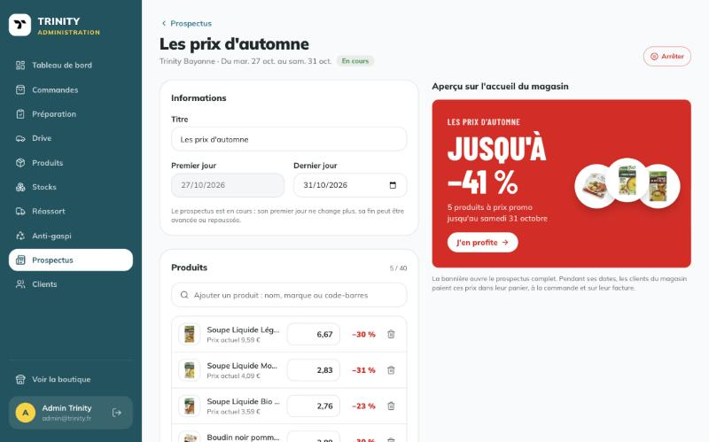

# Trinity Shop

[](https://github.com/antoine-gourgue/Trinity-Shop/actions/workflows/ci.yml)

**Drive en ligne complet, du rayon au parking** : [trinity.antoinegourgue.dev](https://trinity.antoinegourgue.dev)

Le client choisit son magasin parmi 81 drives en France, fait ses courses dans un catalogue de plus de 1 300 produits réels (alimentaire, hygiène et entretien, tous avec la photo officielle du fabricant), réserve un créneau de retrait ou de livraison et paie par carte. Derrière, chaque magasin gère son stock par lots datés, prépare les commandes, accueille ses clients au drive, publie ses prospectus et écoule ses dates courtes en anti-gaspi ; le siège pilote le réseau.

> Le paiement passe par [Stripe](https://stripe.com) en mode test (carte `4242 4242 4242 4242`) : aucun débit réel n'est effectué. Sans clé Stripe, le paiement est simulé.

## Aperçu

| Accueil | Fiche produit |
|---|---|
|  |  |
| **Prospectus du magasin** | **Anti-gaspi** |
|  |  |
| **Rayon Hygiène et Beauté** | **Recherche** |
|  |  |

| **Mobile** | |
|---|---|
|  | Sur mobile : bannières qui défilent, panneaux qui montent du bas de l'écran (choix du magasin, connexion, scanner de code-barres) et barre de navigation en bas. |

### Back-office d'un magasin

| Tableau de bord | Anti-gaspi |
|---|---|
|  |  |
| **Stock par lots et traçabilité** | **Prospectus : saisie et aperçu** |
|  |  |

## En bref

- **Un vrai stock de magasin** : chaque produit est stocké par lots datés (DLC ou DDM). Les commandes reçoivent les dates les plus longues, chaque unité vendue garde son lot (traçabilité en cas de rappel), le réassort arrive le lendemain et entre en stock comme un nouveau lot.
- **Anti-gaspi automatique** : à l'approche de sa date, un lot passe tout seul en vente en ligne, de −20 % à −50 % ; le jour de la date, il est donné ; date passée, il est retiré de la vente et le magasin confirme qu'il est jeté.
- **Prospectus magasin à vrai prix** : chaque magasin publie ses prospectus (titre, dates, produits et prix promo). Pendant ses dates, ces prix s'appliquent partout pour ses clients : catalogue, panier, paiement, commande et facture.
- **Opérations du drive** : préparation article par article (manquants remboursés, remplaçants), arrivée du client sur le parking, remise des courses, indicateurs (temps de préparation, attente au drive, taux de sauvetage anti-gaspi).
- **Prix fiables** : prix entiers en millièmes d'euro, et prix unitaire figé sur chaque ligne de commande : une facture ne bouge plus quand une promotion se termine.
- **Qualité** : TypeScript strict sans aucun `any`, 389 tests Jest, 7 parcours Playwright de bout en bout sur une base jetable, CI obligatoire avant chaque mise en production.

## Sommaire

- [Fonctionnalités](#fonctionnalités)
- [Stack technique](#stack-technique)
- [Structure du dépôt](#structure-du-dépôt)
- [Démarrage en local](#démarrage-en-local)
- [Variables d'environnement](#variables-denvironnement)
- [Commandes](#commandes)
- [Données produits](#données-produits)
- [Règles métier](#règles-métier)
- [Qualité et CI](#qualité-et-ci)
- [Déploiement](#déploiement)
- [Conventions](#conventions)

## Fonctionnalités

### Côté client

- **Accueil** : bannières d'opérations qui défilent (prospectus du magasin, promotions de la semaine, anti-gaspi, drive avec le prochain retrait, Carte Trinity), prospectus du magasin et promotions nationales, rangées anti-gaspi, favoris et sélections.
- **Choix du magasin** : à la première visite, une fenêtre propose les 81 magasins, avec une recherche par ville, code postal ou nom (sans tenir compte des accents), un tri par distance (« Autour de moi », ou autour du magasin actuel) et une carte (Leaflet, OpenStreetMap) synchronisée avec la liste. Le magasin est gardé dans un cookie, puis sur le compte du client connecté. Au changement de magasin, la fenêtre reste ouverte avec un message de chargement jusqu'à ce que la page affiche les prix et les offres du nouveau magasin.
- **Catalogue en 11 rayons** (dont Hygiène et Beauté, Entretien et Maison), avec sous-rayons, pagination et filtres combinables : promotions (y compris celles du prospectus du magasin), bio, tranche de prix, Nutri-Score, marques et gamme (marque U ou marques nationales). Tri par prix, par nom ou par prix au kilo ou au litre.
- **Recherche** tolérante aux accents, avec des suggestions pendant la frappe (sous-rayons et premiers produits, au prix du magasin) et navigation au clavier.
- **Fiche produit** : photo officielle du fabricant, prix et prix au kilo, promotion avec sa date de fin, stock du magasin et date des produits préparés ; pour l'alimentaire, ingrédients avec allergènes, tableau nutritionnel et Nutri-Score ; pour l'hygiène et l'entretien, la composition. Un produit épuisé indique les magasins les plus proches qui l'ont encore.
- **Prospectus du magasin** : bannière et bloc sur l'accueil, page du prospectus complet, prix promo appliqués partout pendant ses dates.
- **Anti-gaspi** : rayon paginé des produits à date courte du magasin (aussi sur l'accueil et la fiche produit). −20 % à J-5 et J-4, −30 % à J-3, −40 % à J-2, −50 % la veille (la veille seulement pour ce qui se conserve peu, comme le pain). La remise s'applique si la date tient jusqu'au créneau choisi.
- **Favoris** : un cœur sur chaque produit, la page « Mes favoris » avec « Tout ajouter au panier », et une rangée sur l'accueil.
- **Panier** conservé sur le compte, qui signale les ruptures ; pour chaque article, le client accepte ou non un produit de remplacement. Un visiteur qui ajoute un produit est invité à se connecter, puis revient sur la page où il était.
- **Tunnel de commande** : retrait gratuit au drive ou livraison à domicile (adresse choisie ou ajoutée à la volée), choix du créneau (8 commandes au plus par heure dans chaque drive, créneaux complets grisés), paiement par carte via Stripe.
- **Suivi de commande** : statut, frise d'avancement, détail de la préparation (manquants, remplaçants, remboursement), facture PDF et « Racheter cette commande ».
- **Arrivée au drive** : une fois les courses prêtes, le client touche « Je suis arrivé » (depuis sa commande ou l'e-mail « commande prête », sans se connecter grâce à un lien signé) et indique sa place sur le parking.
- **Scanner de code-barres** : un produit du catalogue ouvre sa fiche (le chargement reste affiché jusqu'à son arrivée) ; sinon, sa fiche d'Open Food Facts, d'Open Beauty Facts ou d'Open Products Facts s'affiche, avec des produits proches du catalogue en stock dans le magasin (même catégorie, noms et marque les plus proches d'abord) et le lien vers leur rayon.
- **E-mails au design du site** : bienvenue avec confirmation de l'adresse, confirmation de commande avec la facture, suivi à chaque étape, annulation avec le montant remboursé, mot de passe oublié ; et, pour les clients qui l'acceptent, rappel de panier abandonné et alerte quand des favoris passent en promotion (désinscription en un clic).
- **Carte Trinity** (fidélité) : 1 point par euro dépensé, 100 points = un bon de 5 € à utiliser au paiement.
- **Espace client** : magasin, commandes et factures, favoris, adresses, téléphone, informations personnelles, mot de passe et carte de fidélité.
- **Compte** : inscription avec confirmation de l'adresse e-mail, connexion, mot de passe oublié, tentatives limitées contre la force brute.
- **Application installable** (PWA), pages d'information (FAQ, fidélité, contact, mentions légales, confidentialité, cookies) et **référencement** (sitemap, robots.txt, URL canoniques, Open Graph, données structurées schema.org).

### Back-office (`/admin`)

Deux types de comptes : le **siège** (rôle administrateur) gère tout le réseau ; chaque **magasin** a son compte (`magasin-<slug>@trinity.antoinegourgue.dev`), qui arrive directement sur le back-office de son seul magasin (tableau de bord, commandes, préparation, drive, stocks, réassort, anti-gaspi, prospectus) et n'a accès ni à la boutique, ni au catalogue, ni aux clients. Les droits sont vérifiés côté serveur sur chaque action.

- **Tableau de bord** : chiffre d'affaires, panier moyen, clients, ruptures et stocks faibles, avec graphiques ; **indicateurs opérationnels** sur 30 jours (durée de préparation et part des commandes prêtes à l'heure, articles manquants et remplacés, montant remboursé, attente au drive, taux de sauvetage anti-gaspi) et **charge des créneaux** des prochains jours d'ouverture.
- **Commandes** : recherche et filtres (statut, livraison, magasin), détail avec le choix de remplacement de chaque article ; l'équipe fait avancer la commande, l'annule (paiement remboursé, articles remis dans leurs lots, points rétablis, client prévenu) ou supprime une commande annulée.
- **Préparation** : file des commandes par créneau ; l'écran du préparateur liste les articles rayon par rayon, avec les lots à prendre. Chaque article est prélevé, prélevé en partie ou manquant ; un produit équivalent peut le remplacer si le client l'accepte. À la validation, la différence est remboursée sur la carte (remboursement partiel Stripe), le stock est corrigé et le client reçoit le détail par e-mail.
- **Drive** : les clients arrivés sur le parking, avec leur place et leur temps d'attente (mise à jour automatique), puis les commandes prêtes ; « Remis au client » termine la commande.
- **Stocks** : stock de chaque magasin avec la date limite la plus proche ; la fiche d'un stock montre ses lots (reçus, vendus, donnés, jetés, corrigés), les commandes servies par chaque lot (traçabilité) et son réassort. Correction après comptage en rayon.
- **Réassort** : commande d'un produit ou de la quantité suggérée pour ceux sous le seuil ; livraison le lendemain, réception avec la date lue sur les colis. Chaque nuit, un réassort automatique commande les produits sous le seuil.
- **Anti-gaspi** : en haut, les lots à traiter (périmés à jeter, dernier jour à donner, le menu les signale) ; en dessous, les lots en vente, bientôt en vente et clos, en onglets paginés avec leurs nombres exacts ; bilan sur 30 jours (vendus, donnés, jetés, taux de sauvetage).
- **Prospectus** : un magasin (ou le siège, pour le magasin de son choix) crée un prospectus (titre, premier et dernier jour, jusqu'à 40 produits avec leur prix promo) avec l'aperçu en direct de sa bannière sur l'accueil et la remise de chaque produit. Brouillon, programmé, en cours, terminé : publication, retour en brouillon, arrêt immédiat ; il se termine tout seul à minuit après son dernier jour.
- **Produits** (siège) : création à partir du code-barres (fiche pré-remplie depuis Open Food Facts, prix suggéré), édition, promotions nationales avec date de fin, masquage, suppression.
- **Clients** (siège) : rôles et suppression.

## Stack technique

| Domaine | Outils |
|---|---|
| Framework | [Next.js 15](https://nextjs.org) (App Router, server actions, streaming), React 18, TypeScript strict |
| Données | PostgreSQL, [Prisma 5](https://www.prisma.io) |
| Authentification | [Auth.js / NextAuth v5](https://authjs.dev) (identifiants, sessions JWT), bcrypt |
| Interface | Tailwind CSS, composants [shadcn/ui](https://ui.shadcn.com) (Radix), lucide-react, recharts |
| Validation | zod (formulaires, server actions, corps des requêtes API, données externes) |
| Paiement | [Stripe Checkout](https://stripe.com/docs/payments/checkout) (mode test), webhook de confirmation, remboursements partiels |
| Divers | Leaflet et OpenStreetMap (carte des magasins), pdf-lib (factures), Resend + React Email (e-mails), next-pwa, react-qr-barcode-scanner |
| Données ouvertes | Open Food Facts, Open Beauty Facts, Open Products Facts |
| Tests | Jest (unitaires), Playwright (parcours de bout en bout) |
| Hébergement | Vercel (tâches planifiées comprises), base PostgreSQL [Neon](https://neon.tech) |

## Structure du dépôt

```text
.
├── .github/
│   ├── workflows/ci.yml       CI GitHub Actions
│   └── readme/                Captures d'écran de ce README
└── trinity/                   Application Next.js
    ├── app/                   Pages et routes API (App Router)
    │   ├── (customer)/        Accueil, catalogue, rayons, anti-gaspi
    │   ├── (admin)/admin/     Back-office (siège et magasins)
    │   ├── product/           Fiche produit
    │   ├── prospectus/        Prospectus d'un magasin
    │   ├── cart/              Panier et tunnel de commande
    │   ├── drive/             Arrivée au drive (lien signé)
    │   ├── user/              Espace client
    │   ├── auth/              Connexion et inscription
    │   ├── legal/             FAQ et pages légales
    │   └── api/               Routes REST, paiement Stripe, tâches planifiées
    ├── components/            Composants React (catalogue, panier, compte, admin, ui…)
    ├── lib/                   Logique métier : prix, lots, anti-gaspi, prospectus, commandes, server actions
    ├── services/auth/         Inscription, connexion et contrôles d'accès
    ├── schemas/               Schémas zod partagés
    ├── prisma/                Schéma, seed et scripts de données
    ├── data/                  Catalogue et données Open Food Facts (JSON)
    ├── public/products/       Photos produits (une par code-barres)
    ├── __tests__/             Tests Jest
    ├── e2e/                   Parcours Playwright (base jetable uniquement)
    └── test-utils/            Doublures et outils de test
```

## Démarrage en local

Prérequis : **Node.js 22** et une base **PostgreSQL** (locale ou hébergée).

```bash
cd trinity
npm install
cp .env.example .env.local   # puis remplir les variables
```

Créer les tables et remplir la base avec le catalogue. **Le seed commence par vider toute la base** : ne le lancez jamais sur la production.

```bash
npx prisma db push
npx prisma db seed
```

Lancer le serveur de développement sur [http://localhost:3000](http://localhost:3000) :

```bash
npm run dev
```

Le seed crée les 81 magasins et leurs comptes (mot de passe : `SEED_ADMIN_PASSWORD`), le catalogue et le stock de chaque magasin, 100 comptes clients fictifs (au mot de passe aléatoire) et le compte administrateur `admin@trinity.fr`, dont le mot de passe est celui de `SEED_ADMIN_PASSWORD`. Lancez ensuite `prisma/split-stock-into-lots.ts` pour découper ce stock en lots datés.

> Prisma lit `.env`, pas `.env.local`. Pour lancer une commande Prisma avec les variables de `.env.local` : `set -a; source .env.local; set +a; npx prisma db push`.

### Base de développement

En local, `.env.local` ne pointe jamais sur la production. Il pointe sur une **branche Neon `dev`**, copie de la base de production créée en quelques secondes : catalogue, stocks, lots et prospectus réels, sans risque de les modifier. Les accès à la production ne sont définis que dans Vercel.

- **Remettre la branche à jour** : « Reset from parent » dans la console Neon, qui reprend les données de la production.
- **Mise en veille** : la branche s'endort après quelques minutes sans requête ; `connect_timeout=15` dans `POSTGRES_PRISMA_URL` laisse le temps de la réveiller.
- **Ne pas lancer `vercel env pull`** : il réécrirait `.env.local` avec les accès de production.

## Variables d'environnement

Le modèle est dans [`trinity/.env.example`](trinity/.env.example).

| Variable | Rôle |
|---|---|
| `POSTGRES_PRISMA_URL` | URL de connexion avec pool, utilisée par l'application |
| `POSTGRES_URL_NON_POOLING` | URL directe, utilisée par `prisma db push` et les migrations |
| `NEXTAUTH_SECRET` | Clé de signature des sessions et des liens envoyés par e-mail (désinscription, confirmation d'adresse, arrivée au drive) : `openssl rand -base64 32` ; `AUTH_SECRET` est accepté à la place |
| `RESEND_API_KEY` | Facultatif : tous les e-mails ; sans clé, rien n'est envoyé et le lien de réinitialisation s'affiche dans la console en développement |
| `APP_URL` | Facultatif : URL publique du site (liens des e-mails, URL canoniques, Open Graph, sitemap) ; à défaut, le domaine de production Vercel, sinon `http://localhost:3000` |
| `STRIPE_SECRET_KEY` | Facultatif : clé secrète Stripe (`sk_test_…`) ; sans clé, le paiement est simulé |
| `STRIPE_WEBHOOK_SECRET` | Facultatif : secret du webhook Stripe (`whsec_…`) envoyé à `/api/payments/stripe/webhook`, pour créer la commande même si le client ne revient pas sur le site |
| `EMAIL_FROM` | Facultatif : autre expéditeur des e-mails, sur un domaine validé dans Resend ; par défaut `Trinity <no-reply@trinity.antoinegourgue.dev>` |
| `CRON_SECRET` | Secret des tâches planifiées : `/api/cron/maintenance` la nuit (fin des promotions datées, lots périmés retirés de la vente, livraisons de réassort non réceptionnées, réassort automatique, purge des compteurs de tentatives) et `/api/cron/emails` l'après-midi (rappels de panier, alertes promo) |
| `SEED_ADMIN_PASSWORD` | Mot de passe du compte administrateur et des comptes magasin créés par le seed (12 caractères au moins) ; inutile en production |

## Commandes

À lancer depuis `trinity/` :

| Commande | Effet |
|---|---|
| `npm run dev` | Serveur de développement (Turbopack) |
| `npm run build` | Génère le client Prisma puis construit l'application |
| `npm start` | Sert la version construite |
| `npm run lint` | ESLint sur tout le code, tests et scripts compris |
| `npx tsc --noEmit` | Vérification des types |
| `npm test` | Tests Jest |
| `npm run test:e2e` | Parcours Playwright sur la version construite ; ils créent comptes et commandes, donc refusent de tourner hors de la CI sans `E2E_DISPOSABLE_DATABASE=1` |
| `npx prisma db push` | Applique le schéma à la base |
| `npx prisma db seed` | Vide puis remplit la base (catalogue, comptes de démonstration) |
| `npx prisma studio` | Explorateur de la base |

## Données produits

Le catalogue vient de données ouvertes : [Open Food Facts](https://world.openfoodfacts.org) pour l'alimentaire, [Open Beauty Facts](https://world.openbeautyfacts.org) et [Open Products Facts](https://world.openproductsfacts.org) pour l'hygiène et l'entretien. **Seules les photos déposées par les fabricants eux-mêmes** (comptes « org-… » de la plateforme producteurs, alimentée par les fiches GS1) sont retenues, jamais celles prises en rayon : marque U (Système U) et marques nationales (Unilever, Bonduelle, Barilla…). Elles sont servies depuis `public/products/<code-barres>.jpg`.

Les fichiers de `trinity/data/` servent au seed et sont tenus à jour par les scripts :

| Fichier | Contenu |
|---|---|
| `complete_products.json` | Catalogue du seed : nom, code-barres, catégories, marques, prix, contenance |
| `off-enrichment.json` | Contenance et photo par code-barres |
| `national-brands.json` | Produits alimentaires de marques nationales sélectionnés pour l'import |
| `non-food.json` | Produits d'hygiène et d'entretien sélectionnés pour l'import |
| `hidden-products.json` | Codes-barres retirés du catalogue (sans photo officielle) |
| `photo-replacements.json` | Photos officielles qui remplacent d'anciennes photos |

Les scripts, dans `prisma/` et `scripts/`, sont relançables et proposent presque tous un mode `--dry-run`. Leur en-tête précise la commande exacte :

| Script | Rôle |
|---|---|
| `scripts/fetch-off-data.mjs` | Récupère contenances et photos sur Open Food Facts |
| `prisma/fetch-national-brands.ts` | Sélectionne des produits alimentaires de marques nationales avec photo officielle |
| `prisma/fetch-non-food.ts` | Sélectionne les produits d'hygiène et d'entretien avec photo officielle, les range par sous-rayon (d'après leur nom, puis leurs catégories) et télécharge les photos |
| `prisma/import-national-brands.ts` | Importe une sélection en base (`--file data/non-food.json` pour le non alimentaire) : catégories, prix, stock de chaque magasin et lots datés |
| `prisma/apply-pricing.ts` | Calcule des prix et promotions réalistes et déterministes |
| `prisma/hide-products.ts` | Masque les produits listés dans `hidden-products.json` |
| `prisma/replace-photos.ts` | Remplace des photos par la version officielle |
| `prisma/create-store-accounts.ts` | Crée ou met à jour le compte de chaque magasin, avec le mot de passe commun lu dans `STORE_ACCOUNT_PASSWORD` (jamais écrit dans le dépôt) |
| `prisma/split-stock-into-lots.ts` | Durée de conservation de chaque produit (selon son rayon), puis lots datés pour chaque stock qui n'en a pas |
| `prisma/sync-stores.ts` | Enregistre les magasins de `prisma/stores-data.ts` et rattache au magasin historique les commandes passées avant le choix du magasin |

Les fichiers JSON sont validés par des schémas zod (`prisma/data-files.ts`) : un fichier au mauvais format arrête le script avant toute écriture.

## Règles métier

- **Prix** : entiers en millièmes d'euro (`5900` = 5,90 €), ce qui évite les erreurs d'arrondi. Le prix unitaire payé est **figé sur chaque ligne** à la commande (ou à l'ouverture du paiement Stripe) : factures, totaux et remboursements ne changent plus quand une promotion ou un prospectus se termine.
- **Prospectus magasin** : pendant ses dates, un prospectus publié fixe le prix de ses produits pour les clients du magasin, s'il est plus bas que le prix du moment (une promotion nationale plus forte reste la meilleure) ; l'ancien prix devient le prix barré. Le prix saisi doit être une vraie remise, de 80 % au plus.
- **Livraison** : 5,90 €, offerte dès 60 € d'articles ; le retrait au drive est gratuit.
- **Créneaux** : d'une heure, de 9 h à 13 h et de 14 h à 20 h, sur les six prochains jours d'ouverture à partir du lendemain (fermé le dimanche), 8 commandes au plus par créneau et par drive.
- **Préparation** : un article manquant est remboursé au prix payé ; un remplaçant est facturé au prix le plus bas des deux produits. Le remboursement ne dépasse jamais ce que le client a payé pour ses articles.
- **Lots** : le stock d'un magasin est la somme de ses lots en vente. Une commande ne reçoit jamais un lot qui expire avant son créneau : elle prend les dates les plus longues et garde le lot de chaque unité ; l'annulation les rend au même lot ; un comptage retire d'abord les dates les plus courtes. Durées de conservation par rayon : 4 jours pour le pain, 5 pour la viande, 7 pour les fruits et légumes, 3 semaines environ pour la crèmerie, 270 jours pour les surgelés, 300 à 365 pour l'épicerie et les boissons, 3 ans pour l'hygiène et l'entretien.
- **Anti-gaspi** : la remise grandit à l'approche de la date (fenêtre réduite pour ce qui se conserve peu). Les unités à date courte sont réservées dans leur lot à la commande et lui reviennent à l'annulation ; une remise déjà payée reste acquise. Le jour de la date, le lot est donné ; date passée, il est retiré de la vente et jeté. Jamais d'anti-gaspi pour l'hygiène et l'entretien.
- **Fidélité** : 1 point par euro d'articles ; chaque tranche de 100 points donne un bon de 5 €.
- **Accès** : l'identité vient toujours de la session, jamais d'un identifiant envoyé par le navigateur ; le rôle est relu en base à chaque contrôle, et un compte magasin n'agit que sur son magasin.

## Qualité et CI

- TypeScript en mode strict, **sans aucun `any`** : ESLint interdit les `any` explicites et l'usage de valeurs typées `any` (`no-unsafe-*`), dans l'application comme dans les tests et les scripts.
- Les données externes (corps des requêtes, réponses des bases ouvertes, fichiers JSON) sont validées avec zod avant usage.
- **389 tests Jest** : routes API et contrôles d'accès (avec de vrais `NextRequest`), prix et prospectus, lots et anti-gaspi, commandes, paiement, préparation, réassort, scanner.

La [CI GitHub Actions](.github/workflows/ci.yml) tourne à chaque pull request et à chaque push sur `main` :

1. **Lint, types, tests** : `npm run lint`, `tsc --noEmit`, puis Jest ;
2. **Build** : `next build` sur une base PostgreSQL jetable remplie par le seed, puis **7 parcours Playwright** dans Chrome : choix du magasin, compte magasin, recherche, inscription, favoris, panier, créneau, paiement, suivi, rachat, préparation (article prélevé, article manquant) et annulation ; réassort reçu à date courte, acheté en anti-gaspi, préparé, puis arrivée du client au drive et remise de ses courses. La base de production n'est jamais utilisée, ni en CI ni en développement (voir [Base de développement](#base-de-développement)).

## Déploiement

L'application est déployée sur **Vercel**, qui construit chaque commit de `main`. Les jobs **« Lint, types, tests »** et **« Build »** de la CI sont déclarés comme [Deployment Checks](https://vercel.com/docs/deployment-checks) du projet : une nouvelle version n'est mise en ligne qu'une fois la CI réussie.

Variables à définir dans Vercel : `POSTGRES_PRISMA_URL`, `POSTGRES_URL_NON_POOLING`, `NEXTAUTH_SECRET` (ou `AUTH_SECRET`), `CRON_SECRET` et, si besoin, `RESEND_API_KEY`, `STRIPE_SECRET_KEY` et `STRIPE_WEBHOOK_SECRET`.

## Conventions

- Commits au format [Conventional Commits](https://www.conventionalcommits.org) : `type(portée facultative): description`, par exemple `feat(checkout): offer home delivery`.
  Types utilisés : `feat` (fonctionnalité), `fix` (correction), `perf`, `refactor`, `test`, `docs`, `style`, `chore` (outillage, dépendances, données) et `ci`. Un `!` après le type signale un changement incompatible.
- Code et messages de commit en anglais, interface et commentaires en français.
