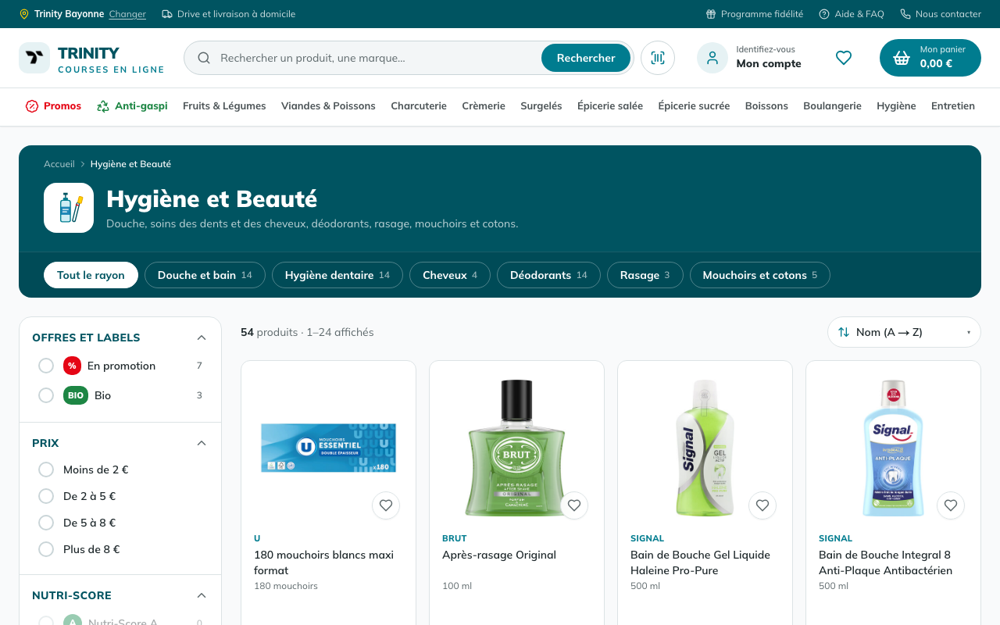
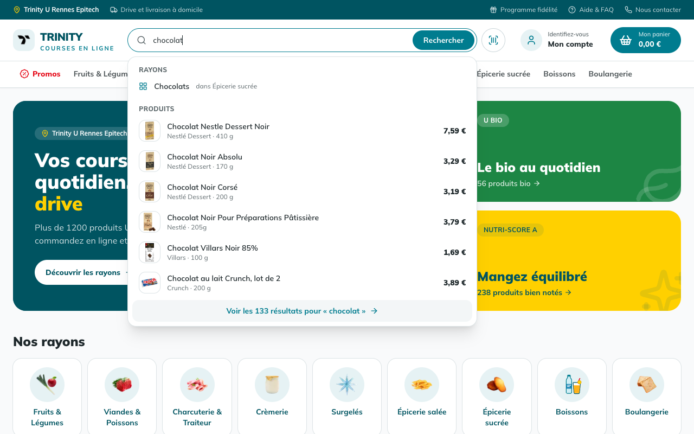
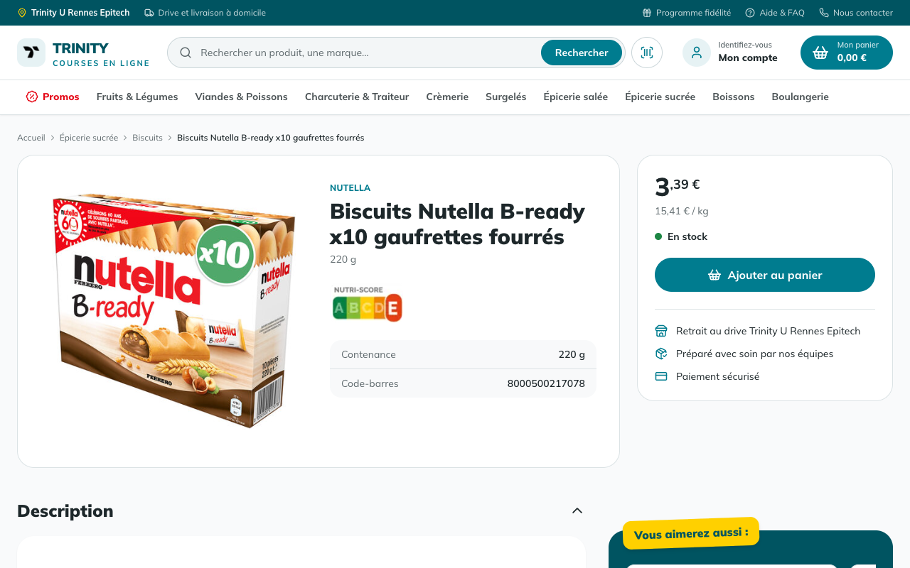
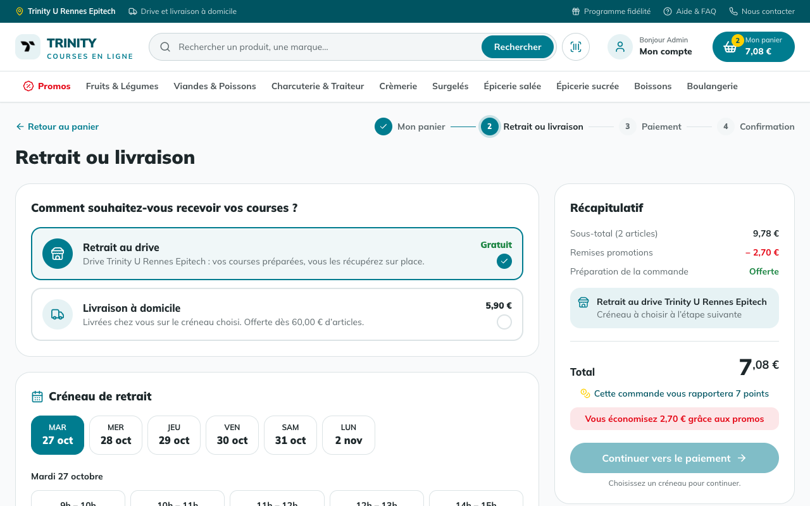
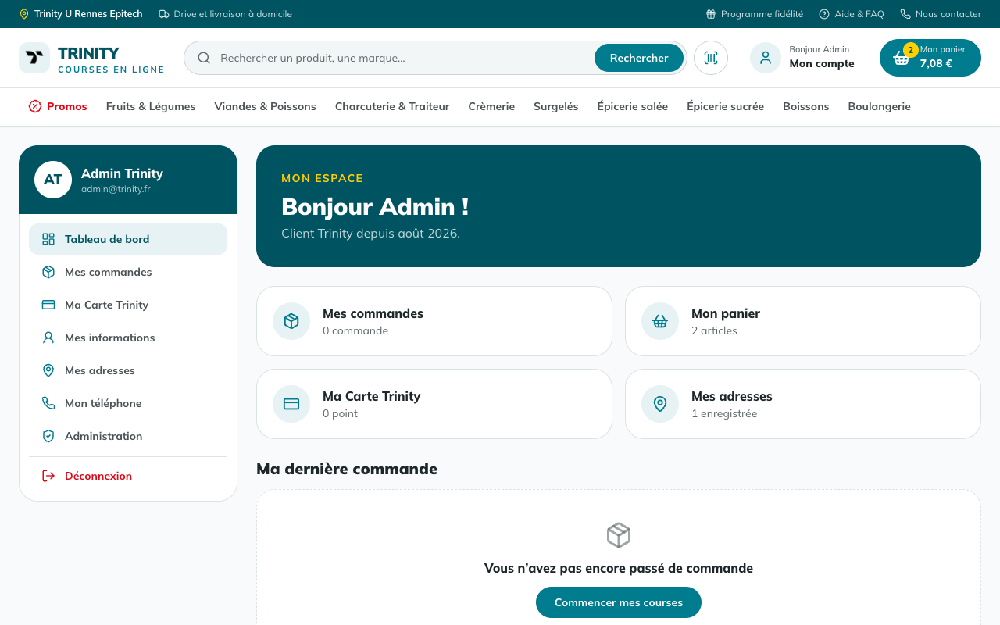
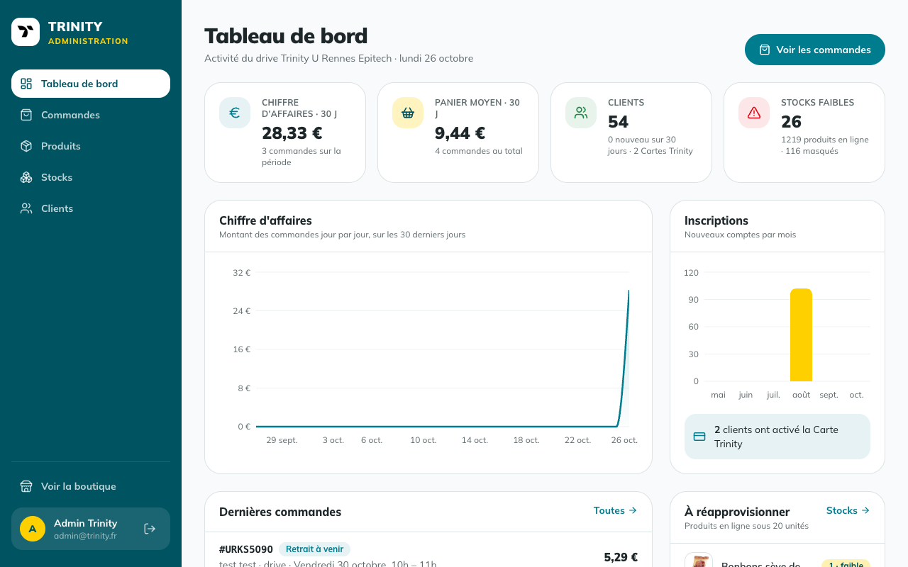
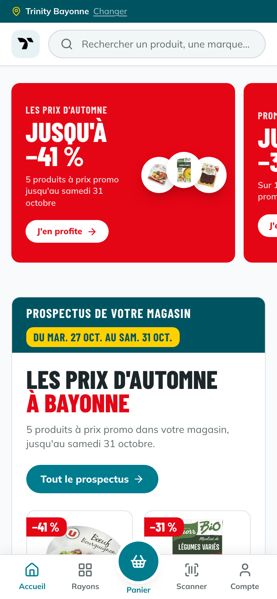

# Trinity Shop

[](https://github.com/antoine-gourgue/Trinity-Shop/actions/workflows/ci.yml)

Supermarché en ligne de type « drive » : le client remplit son panier dans un catalogue de plus de 1 300 produits réels issus d'[Open Food Facts](https://world.openfoodfacts.org), choisit son magasin parmi plus de 80 drives en France, le retrait au drive ou la livraison à domicile sur un créneau d'une heure, puis paie par carte via Stripe, en mode test. Un back-office permet de suivre les commandes, le catalogue, les stocks et les clients.

> Le paiement passe par [Stripe](https://stripe.com) en mode test (carte `4242 4242 4242 4242`) : aucun débit réel n'est effectué. Sans clé Stripe, le paiement est simulé.

## Aperçu

| Accueil | Rayon et filtres |
|---|---|
|  |  |
| **Recherche avec suggestions** | **Fiche produit** |
|  |  |
| **Retrait ou livraison** | **Espace client** |
|  |  |

<table>
  <tr>
    <th>Back-office</th>
    <th>Mobile</th>
  </tr>
  <tr>
    <td></td>
    <td width="240"></td>
  </tr>
</table>

## Sommaire

- [Fonctionnalités](#fonctionnalités)
- [Stack technique](#stack-technique)
- [Structure du dépôt](#structure-du-dépôt)
- [Démarrage en local](#démarrage-en-local)
- [Variables d'environnement](#variables-denvironnement)
- [Commandes](#commandes)
- [Données produits](#données-produits)
- [Règles métier](#règles-métier)
- [Qualité et CI](#qualité-et-ci)
- [Déploiement](#déploiement)
- [Conventions](#conventions)

## Fonctionnalités

### Côté client

- **Choix du magasin** : à la première visite, une fenêtre propose les 81 magasins Trinity, avec une recherche par ville, code postal ou nom (sans tenir compte des accents) un tri par distance (« Autour de moi », ou autour du magasin actuel) et une carte des magasins (Leaflet, OpenStreetMap), synchronisée avec la liste. Le magasin est gardé dans un cookie, puis sur le compte du client connecté : il le retrouve sur tous ses appareils et peut en changer depuis le haut de chaque page. Le catalogue et les prix sont communs à tous les magasins ; chacun a son propre stock.
- **Catalogue par rayons** avec sous-rayons, pagination et filtres combinables : promotions, bio, tranche de prix, Nutri-Score, marques (avec recherche quand la liste est longue) et gamme (marque U ou marques nationales).
- **Tri** par prix, par nom ou par prix au kilo ou au litre, calculé à partir de la contenance du produit.
- **Recherche** tolérante aux accents, avec des suggestions pendant la frappe : rayons correspondants et premiers produits, avec navigation au clavier.
- **Stock par magasin, par lots datés** : chaque drive a son stock, fait de lots qui ont chacun leur date limite (DLC ou DDM). Les commandes reçoivent les dates les plus longues du rayon, et la fiche produit indique la date des produits préparés. La fiche produit, le panier, le rachat et l'ajout des favoris suivent le magasin choisi ; un produit épuisé dans ce magasin indique les magasins les plus proches qui l'ont encore.
- **Fiche produit** : photo officielle du fabricant, prix et prix au kilo, promotion (avec sa date de fin), ingrédients avec allergènes mis en évidence, tableau nutritionnel, Nutri-Score, produits similaires.
- **Favoris** : un cœur sur chaque produit et dans l'en-tête (avec leur nombre), la page « Mes favoris » avec « Tout ajouter au panier » pour refaire ses courses habituelles en un clic, et une rangée « Vos favoris » sur l'accueil.
- **Anti-gaspi** : un rayon des produits à date courte du magasin choisi (aussi en rangée sur l'accueil et sur la fiche produit), alimenté tout seul par les lots du stock. Le prix baisse à l'approche de la date limite : −20 % à J-5 et J-4, −30 % à J-3, −40 % à J-2, −50 % la veille (la veille seulement pour un produit qui se conserve peu, comme le pain). La remise s'applique au paiement si la date tient jusqu'au créneau choisi.
- **Panier** conservé sur le compte, qui signale les ruptures de stock ; pour chaque article, le client accepte ou non un produit de remplacement, et voit l'offre anti-gaspi choisie.
- **Tunnel de commande** : retrait gratuit au drive du magasin choisi ou livraison à domicile depuis ce magasin (adresse choisie ou ajoutée à la volée), choix du créneau (8 commandes au plus par heure dans chaque drive, créneaux complets grisés), puis paiement par carte via Stripe. Le stock est décompté à la commande.
- **Suivi de commande** : statut (reçue, en préparation, prête, retirée ou livrée, annulée) et frise d'avancement, et « Racheter cette commande ».
- **Arrivée au drive** : une fois les courses prêtes, le client touche « Je suis arrivé » (depuis sa commande ou l'e-mail « commande prête », sans avoir à se connecter grâce à un lien signé) et indique sa place sur le parking ; un équipier lui apporte ses courses.
- **E-mails au design du site** : bienvenue avec confirmation de l'adresse, confirmation de commande avec la facture PDF, suivi à chaque étape (en préparation, prête au drive ou en route, retirée ou livrée), annulation avec le montant remboursé, mot de passe oublié.
- **E-mails commerciaux** : rappel de panier abandonné (un seul par panier) et alerte quand des favoris passent en promotion (une seule par promotion), envoyés seulement vers une adresse confirmée, chacun avec sa désinscription en un clic et son réglage dans l'espace client.
- **Carte Trinity** (fidélité) : 1 point par euro dépensé, 100 points = un bon de 5 € à utiliser au paiement.
- **Espace client** : magasin du compte, commandes et factures PDF, favoris, adresses, téléphone, informations personnelles, mot de passe et carte de fidélité.
- **Compte** : inscription avec confirmation de l'adresse e-mail (lien signé valable 7 jours, renvoyable depuis l'espace client, redemandé après un changement d'adresse), connexion, mot de passe oublié par lien envoyé par e-mail (valable une heure), tentatives limitées contre les attaques par force brute.
- **Scanner de code-barres** : un produit du catalogue ouvre sa fiche, sinon la fiche Open Food Facts s'affiche.
- **Application installable** (PWA) et pages d'information : FAQ, programme de fidélité, contact, mentions légales, confidentialité, cookies.
- **Référencement** : sitemap, robots.txt, URL canoniques, Open Graph et données structurées schema.org sur les fiches produit.

### Back-office (`/admin`)

Deux types de comptes : le **siège** (rôle administrateur) gère tout le réseau ; chaque **magasin** a son compte (`magasin-<slug>@trinity.antoinegourgue.dev`), qui arrive directement sur le back-office de son seul magasin (tableau de bord, commandes, préparation, drive, stocks, réassort, anti-gaspi) et n'a accès ni à la boutique, ni au catalogue, ni aux clients. Les droits sont vérifiés côté serveur sur chaque commande et chaque stock.

- **Tableau de bord** : chiffre d'affaires, commandes, clients et inscriptions sur la période, ruptures et stocks faibles, avec graphiques ; tout le réseau pour le siège, son magasin pour un compte magasin.
- **Indicateurs opérationnels** (tableau de bord, 30 jours) : durée moyenne de préparation et part des commandes prêtes avant leur créneau, taux d'articles manquants et de remplacement, montant remboursé, attente moyenne au drive, taux de sauvetage anti-gaspi, commandes en retard, et grille de charge des créneaux (jours × heures) sur les prochains jours d'ouverture.
- **Commandes** : recherche, filtres par statut, livraison et magasin, détail avec le choix de remplacement de chaque article ; l'équipe fait avancer la commande d'une étape à l'autre, l'annule (paiement par carte remboursé, articles remis en stock, points de fidélité rétablis, client prévenu par e-mail) ou supprime une commande annulée.
- **Préparation** : file des commandes à préparer, classées par créneau, avec leur avancement. L'écran du préparateur liste les articles rayon par rayon ; chacun est prélevé, prélevé en partie ou signalé manquant. Si le client a accepté les remplacements, un produit équivalent en stock dans le magasin (même catégorie, prix le plus proche) peut remplacer ce qui manque. À la validation, la différence est remboursée sur la carte (remboursement partiel Stripe), le stock du magasin est corrigé, la commande passe « prête » et le client reçoit le détail des changements par e-mail ; sa facture et sa page de commande les reprennent.
- **Drive** : les clients arrivés sur le parking, par ordre d'arrivée, avec leur place et leur temps d'attente (la page se met à jour seule), puis les commandes prêtes qui attendent leur client ; « Remis au client » termine la commande et envoie le remerciement.
- **Réassort** : le magasin commande un produit (cherché par nom ou code-barres), ou la quantité suggérée pour les produits sous le seuil (deux semaines de ventes). La livraison arrive le lendemain ; à la réception, le magasin vérifie la quantité et la date lue sur les colis, et le lot entre en stock. Chaque nuit, un réassort automatique commande les produits sous le seuil, et une livraison non réceptionnée la veille entre en stock à la date habituelle du produit.
- **Anti-gaspi** : les lots à l'approche de leur date passent tout seuls en vente en ligne à prix réduit ; à la date, le reste est donné à l'association partenaire (convention de don, loi Garot), sauf ce que le magasin déclare jeté, et quitte le stock. Le bilan (unités vendues à prix réduit, données, jetées, taux de sauvetage) suit sur 30 jours.
- **Produits** : création à partir du code-barres (fiche pré-remplie depuis Open Food Facts : catégories du site, photo, prix suggéré), édition, promotions avec date de fin, masquage du catalogue, suppression (refusée si le produit a déjà été commandé).
- **Stocks** : stock de chaque magasin (ou de tout le réseau) avec la date limite la plus proche, filtres stock faible et rupture, correction après comptage (les unités en moins sortent des dates les plus courtes). La fiche d'un stock montre ses lots (reçus, vendus, donnés, jetés, corrigés), les commandes servies par chaque lot (traçabilité, en cas de rappel) et son réassort. Un nouveau produit reçoit un premier lot dans chaque magasin, daté selon sa durée de conservation (déduite de son rayon).
- **Clients** : rôles et suppression.

## Stack technique

| Domaine | Outils |
|---|---|
| Framework | [Next.js 15](https://nextjs.org) (App Router, server actions), React 18, TypeScript strict |
| Données | PostgreSQL, [Prisma 5](https://www.prisma.io) |
| Authentification | [Auth.js / NextAuth v5](https://authjs.dev) (identifiants, sessions JWT), bcrypt |
| Interface | Tailwind CSS, composants [shadcn/ui](https://ui.shadcn.com) (Radix), lucide-react, recharts |
| Validation | zod (formulaires, corps des requêtes API, données externes) |
| Paiement | [Stripe Checkout](https://stripe.com/docs/payments/checkout) (mode test), webhook de confirmation |
| Divers | Leaflet et OpenStreetMap (carte des magasins), pdf-lib (factures), Resend + React Email (e-mails de compte, de commande, rappels et alertes), next-pwa, react-qr-barcode-scanner |
| Tests | Jest (unitaires), Playwright (parcours de bout en bout) |
| Hébergement | Vercel, base PostgreSQL [Neon](https://neon.tech) |

## Structure du dépôt

```text
.
├── .github/
│   ├── workflows/ci.yml       CI GitHub Actions
│   └── readme/                Captures d'écran de ce README
└── trinity/                   Application Next.js
    ├── app/                   Pages et routes API (App Router)
    │   ├── (customer)/        Accueil, catalogue, rayons
    │   ├── (admin)/admin/     Back-office
    │   ├── product/           Fiche produit
    │   ├── cart/              Panier et tunnel de commande
    │   ├── user/              Espace client
    │   ├── auth/              Connexion et inscription
    │   ├── legal/             FAQ et pages légales
    │   └── api/               Routes REST (produits, stocks, paniers, commandes, utilisateurs)
    ├── components/            Composants React (catalogue, panier, compte, admin, ui…)
    ├── lib/                   Logique métier, requêtes, server actions
    ├── services/auth/         Inscription, connexion et contrôles d'accès
    ├── schemas/               Schémas zod partagés
    ├── types/                 Types de session NextAuth
    ├── prisma/                Schéma, seed et scripts de données
    ├── data/                  Catalogue et données Open Food Facts (JSON)
    ├── public/products/       Photos produits (une par code-barres)
    ├── __tests__/             Tests Jest
    ├── e2e/                   Parcours Playwright (base jetable uniquement)
    └── test-utils/            Doublures et outils de test
```

## Démarrage en local

Prérequis : **Node.js 22** et une base **PostgreSQL** (locale ou hébergée).

```bash
cd trinity
npm install
cp .env.example .env.local   # puis remplir les variables
```

Créer les tables et remplir la base avec le catalogue. **Le seed commence par vider toute la base** : ne le lancez jamais sur la production.

```bash
npx prisma db push
npx prisma db seed
```

Lancer le serveur de développement sur [http://localhost:3000](http://localhost:3000) :

```bash
npm run dev
```

Le seed crée les 81 magasins et leurs comptes (mot de passe : `SEED_ADMIN_PASSWORD`), le catalogue et le stock de chaque magasin, 100 comptes clients fictifs (au mot de passe aléatoire) et le compte administrateur `admin@trinity.fr`, dont le mot de passe est celui de `SEED_ADMIN_PASSWORD`.

> Prisma lit `.env`, pas `.env.local`. Pour lancer une commande Prisma avec les variables de `.env.local` : `set -a; source .env.local; set +a; npx prisma db push`.

## Variables d'environnement

Le modèle est dans [`trinity/.env.example`](trinity/.env.example).

| Variable | Rôle |
|---|---|
| `POSTGRES_PRISMA_URL` | URL de connexion avec pool, utilisée par l'application |
| `POSTGRES_URL_NON_POOLING` | URL directe, utilisée par `prisma db push` et les migrations |
| `NEXTAUTH_SECRET` | Clé de signature des sessions et des liens envoyés par e-mail : désinscription, confirmation d'adresse (`openssl rand -base64 32`) ; `AUTH_SECRET` est accepté à la place |
| `RESEND_API_KEY` | Facultatif : tous les e-mails (compte, commandes, rappels de panier, alertes promo) ; sans clé, rien n'est envoyé et le lien de réinitialisation s'affiche dans la console en développement |
| `APP_URL` | Facultatif : URL publique du site (liens des e-mails, URL canoniques, Open Graph, sitemap, robots.txt) ; à défaut, le domaine de production Vercel, sinon `http://localhost:3000` |
| `STRIPE_SECRET_KEY` | Facultatif : clé secrète Stripe (`sk_test_…`) pour le paiement par carte ; sans clé, le paiement est simulé |
| `STRIPE_WEBHOOK_SECRET` | Facultatif : secret du webhook Stripe (`whsec_…`) envoyé à `/api/payments/stripe/webhook`, pour créer la commande même si le client ne revient pas sur le site |
| `EMAIL_FROM` | Facultatif : autre expéditeur des e-mails, sur un domaine validé dans le compte Resend de la clé ; par défaut `Trinity <no-reply@trinity.antoinegourgue.dev>` |
| `CRON_SECRET` | Secret des tâches planifiées : `/api/cron/maintenance` la nuit (fin des promotions datées, purge des compteurs de tentatives) et `/api/cron/emails` l'après-midi (rappels de panier, alertes promo des favoris) ; Vercel l'envoie à chaque appel |
| `SEED_ADMIN_PASSWORD` | Mot de passe du compte administrateur créé par le seed (12 caractères au moins) ; inutile en production |

## Commandes

À lancer depuis `trinity/` :

| Commande | Effet |
|---|---|
| `npm run dev` | Serveur de développement (Turbopack) |
| `npm run build` | Génère le client Prisma puis construit l'application |
| `npm start` | Sert la version construite |
| `npm run lint` | ESLint sur tout le code, tests et scripts compris |
| `npx tsc --noEmit` | Vérification des types |
| `npm test` | Tests Jest |
| `npm run test:e2e` | Parcours Playwright sur la version construite ; ils créent comptes et commandes, donc refusent de tourner hors de la CI sans `E2E_DISPOSABLE_DATABASE=1` |
| `npx prisma db push` | Applique le schéma à la base |
| `npx prisma db seed` | Vide puis remplit la base (catalogue, comptes de démonstration) |
| `npx prisma studio` | Explorateur de la base |

## Données produits

Le catalogue vient d'Open Food Facts. Les fichiers de `trinity/data/` servent au seed et sont tenus à jour par les scripts de données :

| Fichier | Contenu |
|---|---|
| `complete_products.json` | Catalogue du seed : nom, code-barres, catégories, marques, prix, contenance |
| `off-enrichment.json` | Contenance et photo par code-barres |
| `national-brands.json` | Produits de marques nationales sélectionnés pour l'import |
| `hidden-products.json` | Codes-barres retirés du catalogue (sans photo officielle) |
| `photo-replacements.json` | Photos officielles qui remplacent d'anciennes photos |

Les photos sont servies depuis `public/products/<code-barres>.jpg`. Seules les photos déposées par les fabricants (comptes « org-… » d'Open Food Facts) sont retenues, pas celles prises en rayon.

Les scripts, dans `prisma/` et `scripts/`, sont relançables et proposent presque tous un mode `--dry-run`. Leur en-tête précise la commande exacte :

| Script | Rôle |
|---|---|
| `scripts/fetch-off-data.mjs` | Récupère contenances et photos sur Open Food Facts |
| `prisma/fetch-national-brands.ts` | Sélectionne des produits de marques nationales avec photo officielle |
| `prisma/import-national-brands.ts` | Importe ces produits en base et dans les données du seed |
| `prisma/apply-pricing.ts` | Calcule des prix et promotions réalistes et déterministes |
| `prisma/hide-products.ts` | Masque les produits listés dans `hidden-products.json` |
| `prisma/replace-photos.ts` | Remplace des photos par la version officielle |
| `prisma/create-store-accounts.ts` | Crée ou met à jour le compte de chaque magasin, avec le mot de passe commun lu dans `STORE_ACCOUNT_PASSWORD` (jamais écrit dans le dépôt) |
| `prisma/split-stock-into-lots.ts` | Passage au stock par lots : durée de conservation de chaque produit (selon son rayon), puis lots datés pour chaque stock qui n'en a pas (un lot récent, un plus ancien et, pour le frais, parfois un lot à date courte). Relançable |
| `prisma/sync-stores.ts` | Enregistre les magasins de `prisma/stores-data.ts` (création ou mise à jour) et rattache au magasin historique de Rennes les commandes passées avant le choix du magasin |

Les fichiers JSON sont validés par des schémas zod (`prisma/data-files.ts`) : un fichier au mauvais format arrête le script avant toute écriture.

## Règles métier

- **Prix** : entiers en millièmes d'euro (`5900` = 5,90 €), ce qui évite les erreurs d'arrondi.
- **Livraison** : 5,90 €, offerte dès 60 € d'articles ; le retrait au drive est gratuit. Une commande livrée est une commande qui a une adresse de livraison.
- **Créneaux** : d'une heure, de 9 h à 13 h et de 14 h à 20 h, sur les six prochains jours d'ouverture à partir du lendemain (fermé le dimanche).
- **Préparation** : un article manquant est remboursé ; un remplaçant est facturé au prix le plus bas des deux produits (un remplaçant plus cher ne coûte rien de plus). Le remboursement ne dépasse jamais ce que le client a payé pour ses articles, bons fidélité déduits.
- **Lots** : le stock d'un magasin est la somme de ses lots ouverts. Une commande prend les unités des dates les plus longues et garde le lot de chaque unité ; l'annulation les rend au même lot ; un article introuvable à la préparation remet ses lots à zéro (correction d'inventaire). Durées de conservation par rayon : 4 jours pour le pain, 5 pour la viande, 7 pour les fruits et légumes, 3 semaines environ pour la crèmerie, 270 jours pour les surgelés, 300 à 365 pour l'épicerie et les boissons.
- **Anti-gaspi** : les unités à date courte d'un lot sont servies en premier sur la ligne du panier qui a choisi l'offre ; elles sont réservées dans le lot à la commande et lui reviennent à l'annulation. Une remise déjà payée par carte reste acquise même si un autre client a pris les dernières unités entre-temps. Un article anti-gaspi manquant à la préparation est remboursé au prix payé.
- **Fidélité** : 1 point par euro d'articles ; chaque tranche de 100 points donne un bon de 5 €. Les points d'une commande supprimée sont rendus.
- **Accès** : l'identité vient toujours de la session, jamais d'un identifiant envoyé par le navigateur ; le rôle administrateur est relu en base à chaque contrôle.

## Qualité et CI

- TypeScript en mode strict, **sans aucun `any`** : ESLint interdit les `any` explicites et l'usage de valeurs typées `any` (`no-unsafe-*`), dans l'application comme dans les tests et les scripts.
- Les données externes (corps des requêtes API, réponses d'Open Food Facts, fichiers JSON) sont validées avec zod avant usage.
- Les tests Jest couvrent les routes API et les contrôles d'accès ; ils appellent les handlers avec de vrais `NextRequest`.

La [CI GitHub Actions](.github/workflows/ci.yml) tourne à chaque pull request et à chaque push sur `main` :

1. **Lint, types, tests** : `npm run lint`, `tsc --noEmit`, puis Jest ;
2. **Build** : `next build` sur une base PostgreSQL jetable, remplie par le seed, puis les parcours Playwright dans Chrome : choix du magasin, compte magasin, recherche, inscription, favoris, panier, créneau, paiement, suivi, rachat, puis préparation (article prélevé, article manquant) et annulation par l'équipe ; réassort reçu à date courte (donc en anti-gaspi), acheté, préparé, puis arrivée du client au drive et remise de ses courses. La base de production n'est jamais utilisée.

## Déploiement

L'application est déployée sur **Vercel**, qui construit chaque commit de `main`. Les jobs **« Lint, types, tests »** et **« Build »** de la CI sont déclarés comme [Deployment Checks](https://vercel.com/docs/deployment-checks) du projet Vercel : une nouvelle version de production n'est mise en ligne qu'une fois la CI réussie (attente de 15 minutes au plus).

Variables à définir dans Vercel : `POSTGRES_PRISMA_URL`, `POSTGRES_URL_NON_POOLING`, `NEXTAUTH_SECRET` (ou `AUTH_SECRET`) et, si besoin, `RESEND_API_KEY`.

## Conventions

- Commits au format [Conventional Commits](https://www.conventionalcommits.org) : `type(portée facultative): description`, par exemple `feat(checkout): offer home delivery`.
  Types utilisés : `feat` (fonctionnalité), `fix` (correction), `refactor`, `test`, `docs`, `style`, `chore` (outillage, dépendances) et `ci`. Un `!` après le type signale un changement incompatible.
- Code et messages de commit en anglais, interface et commentaires en français.
